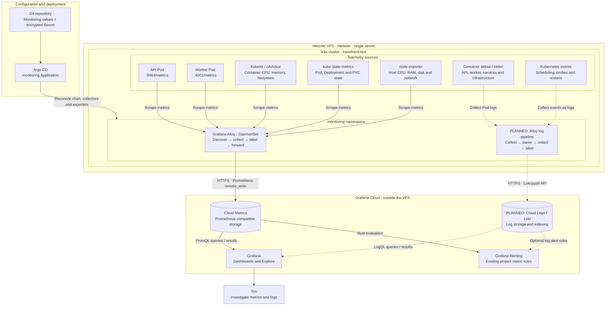

# Monitoring architecture

TravelNest's current metrics pipeline and proposed Loki logging pipeline.
Solid arrows show configured flows; dashed arrows show planned additions.

Diagram files: [Mermaid source](../diagrams/monitoring/architecture.mmd) ·
[SVG](../diagrams/monitoring/architecture.svg) ·
[PNG](../diagrams/monitoring/architecture.png).

The Loki design below assumes **Grafana Cloud Logs (managed Loki)**. It is a
proposal, not an implemented logging pipeline. Configuration was checked on
2026-11-22; the single-server topology comes from the supplied production
inspection baseline, not a new live inspection.

The planned log pipeline is a logical part of Alloy, not necessarily a separate
collector or Deployment. Exporters are grouped by their role as telemetry
sources; the diagram does not imply that they share a namespace with the apps.

## Responsibilities

| Component | Role |
| --- | --- |
| k3s | Runs applications and monitoring collectors. |
| Exporters | Expose host and Kubernetes information as scrapeable metrics. |
| Alloy | Discovers targets, collects telemetry, and forwards it to storage backends. |
| Cloud Metrics | Stores numerical time series such as request counts, latency, CPU, memory, and restarts. |
| Loki — planned | Stores logs collected by Alloy and supports LogQL queries. |
| Grafana | Queries storage backends and displays dashboards, metrics, and logs. |
| Grafana Alerting | Evaluates rules against stored telemetry. |
| Argo CD | Reconciles monitoring configuration from Git into Kubernetes. |

## Repository configuration

- [Monitoring values](../../deploy/k8s/monitoring/values.yaml): enables
  `clusterMetrics`, `hostMetrics`, and `annotationAutodiscovery`; configures the
  Alloy collector, exporters, and Grafana Cloud metrics destination.
- [Monitoring Argo CD Application](../../deploy/k8s/environments/prod/monitoring.yaml):
  deploys the monitoring chart using repository values and encrypted secrets.
- [API Deployment](../../deploy/k8s/apps/api/base/deployment.yaml): exposes the
  dedicated metrics port and scrape annotations.
- [Worker Deployment](../../deploy/k8s/apps/worker/base/deployment.yaml): exposes
  metrics on the worker's health port and declares scrape annotations.

There is currently no configured Loki destination or enabled log collection
pipeline in the monitoring values. The `filesystem-log-reader` preset alone
does not establish log collection and delivery.

## Planned logging scope

Collect container stdout/stderr and optionally Kubernetes events using Alloy,
then send them to Grafana Cloud Logs. Configure parsing, redaction, and stable
labels before enabling ingestion. Host systemd journals, including host-run
`cloudflared` and `k3s`, require additional collection configuration and are not
included in the proposed Pod log flow above.

Metrics answer questions such as “When did API errors rise, and did CPU or
restarts rise too?” Logs answer “What errors did the API emit during that
period?” Consistent cluster, namespace, and workload labels help connect the
two during an investigation.

If Loki will instead be self-hosted inside k3s, move the Loki backend into the
cluster and design its storage, retention, and connectivity from Grafana Cloud.
That option places the log backend on the same server being monitored.

## References

- [Alloy Prometheus remote write](https://grafana.com/docs/grafana-cloud/send-data/alloy/reference/components/prometheus/prometheus.remote_write/)
- [Collect logs with Alloy](https://grafana.com/docs/grafana-cloud/send-data/logs/collect-logs-with-alloy/)
- [Collect Kubernetes logs and forward them to Loki](https://grafana.com/docs/grafana-cloud/send-data/alloy/collect/logs-in-kubernetes/)
