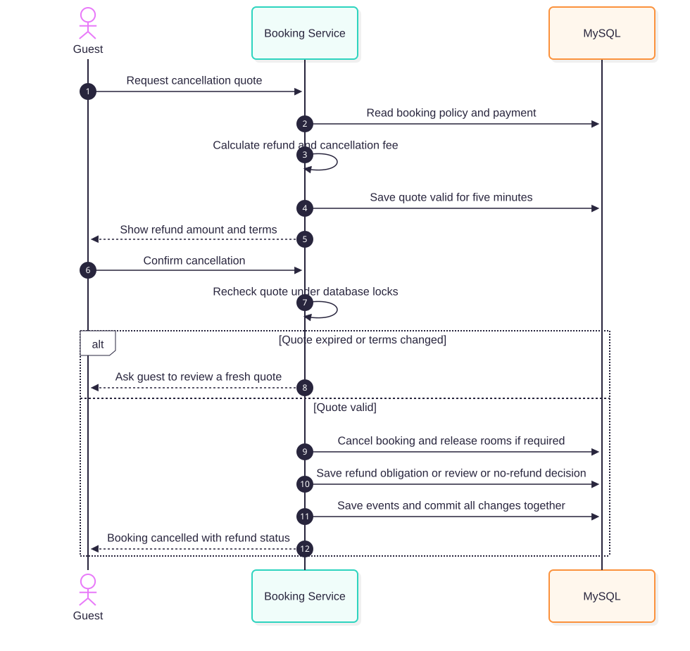
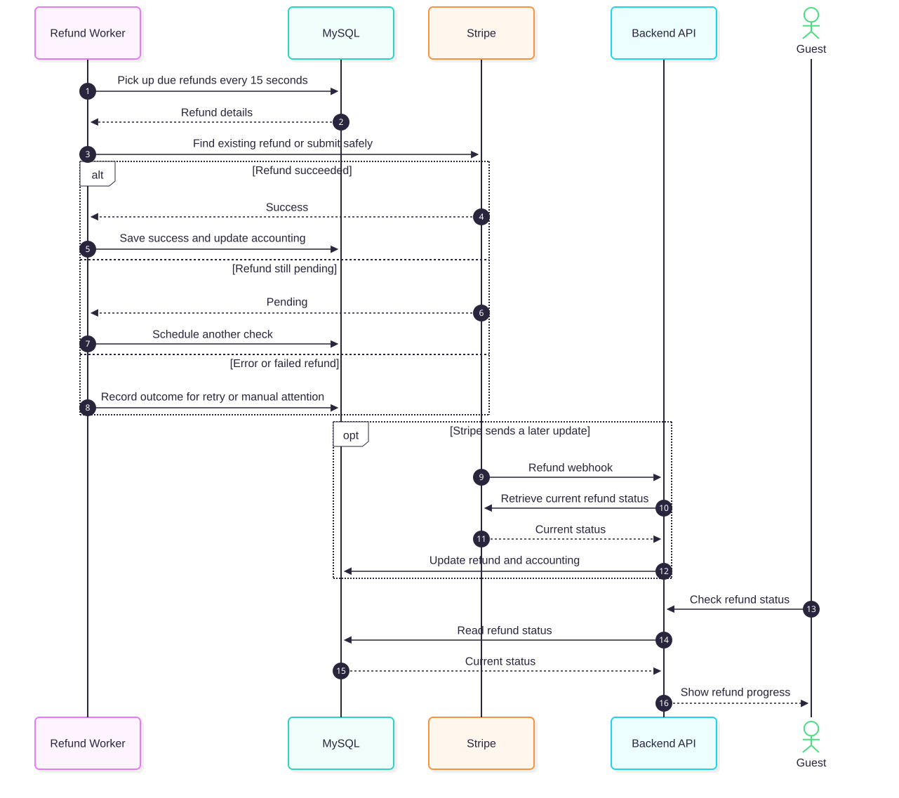

# Cancellation and refund diagrams

These diagrams describe the cancellation and refund implementation in the repository. Mermaid sources are editable; SVG and PNG files are rendered previews. The ERD shows selected fields and relationships, not the complete schema.

| Diagram | Mermaid source | Rendered images |
| --- | --- | --- |
| Consolidated components | [components.mmd](components.mmd) | [SVG](components.svg) · [PNG](components.png) |
| Component overview | [components-overview.mmd](components-overview.mmd) | [SVG](components-overview.svg) · [PNG](components-overview.png) |
| Processing components | [components-processing.mmd](components-processing.mmd) | [SVG](components-processing.svg) · [PNG](components-processing.png) |
| Guest cancellation sequence | [sequence-cancellation.mmd](sequence-cancellation.mmd) | [SVG](sequence-cancellation.svg) · [PNG](sequence-cancellation.png) |
| Refund processing sequence | [sequence-refund.mmd](sequence-refund.mmd) | [SVG](sequence-refund.svg) · [PNG](sequence-refund.png) |
| Entity relationships | [erd.mmd](erd.mmd) | [SVG](erd.svg) · [PNG](erd.png) |

## Components



The consolidated view shows cancellation and refund responsibilities together. Access-control and repository layers are omitted for readability. The shared reconciliation and ledger services run inside the calling API or worker process; they are not a separate deployed service.





The API and worker are separate processes that reuse application services. MySQL stores the durable refund obligations and outbox events. Redis/BullMQ schedules scans; losing Redis jobs does not delete the SQL obligations. Schedules must be registered again after schedule loss.

## Guest cancellation



The guest first reviews a five-minute quote computed from the policy snapshot saved with the booking, payment data, and already committed refunds. Confirmation recalculates the quote under locks. Cancellation, any refund/review record, inventory release, and outbox events commit together. Stripe is contacted later.

The simplified sequence groups booking, payment, and inventory services into one backend participant. Database locks, replay handling, and individual refund/review branches are summarized. The save steps are one database transaction, not separate commits.

An admin force-cancellation uses the same cancellation service with an override rather than requiring a guest quote. Authorized admin review resolution can create a refund obligation or record a zero-refund decision. Those branches are omitted from the guest sequence.

## Refund processing



The simplified sequence shows refund submission, result handling, later webhooks, and guest status checks. It groups shared reconciliation code into the worker/API participants and omits leasing, event delivery, and detailed retry branches. The recovery job scans up to 50 due records every 15 seconds and processes batches of five in parallel. Each attempt uses database leases and a stable Stripe idempotency key. Retry backoff is separate from the polling interval; uncertain results keep funds reserved. A provider-confirmed failure is distinct from an unknown outcome.

Worker responses and webhooks use shared reconciliation to update refund state, payment totals, ledger entries, and terminal outbox events atomically. A daily provider-to-ledger sweep checks existing refunds without creating new provider refunds; it is omitted from the sequence for readability.

Outbox publication goes to event subscribers; successful delivery is acknowledged in MySQL. Delivery can repeat, so subscribers must be idempotent. Obsolete refund-success events are retired if the refund is no longer successful.

## Entity relationships



- Cancellation policy, quote, and decision are JSON columns on `bookings`, not separate tables. `cancellation_decision.refundId` is an application reference inside JSON, not a foreign key.
- A booking/payment can have multiple refund records, including manual review, partial refunds, and replacement obligations.
- The booking-to-transaction relationship reflects the nullable, non-unique database foreign key. The booking model exposes a single transaction association.
- `ledger_entries.refund_id` is nullable because the ledger also records other financial events. Other ledger foreign keys are omitted here.
- `payment_outbox` has no foreign keys to bookings or refunds. Event payloads carry the related identifiers, so the table is drawn separately.
- `PK`, `FK`, and `UK` mean primary, foreign, and unique keys. `||` means exactly one, `|o` zero or one, and `o{` zero or many.

## Source code

Paths are relative to the repository root:

- `server/modules/booking/application/guest/{cancellationQuote,cancelBooking}.js`
- `server/modules/booking/application/admin/forceCancelBooking.js`
- `server/modules/booking/domain/cancellation-policy.js`
- `server/modules/payment/application/{refund-obligations,reconcileRefund,reconcileRefunds}.js`
- `server/modules/payment/application/admin/processRefundAttempt.js`
- `server/modules/payment/application/webhooks/handleRefundSucceeded.js`
- `server/modules/payment/jobs/refunds.js`
- `server/modules/booking/infrastructure/models/booking.model.js`
- `server/modules/payment/infrastructure/models/{transaction,refund,ledger_entry,ledger_account,payment_outbox}.model.js`

## Regeneration

With Mermaid CLI installed, render each source to SVG and PNG:

```sh
for source in docs/diagrams/cancellation-refunds/*.mmd; do
  mmdc -i "$source" -o "${source%.mmd}.svg" -b white
  mmdc -i "$source" -o "${source%.mmd}.png" -b white -s 2
done
```

If Chrome needs an explicit executable path, pass Mermaid CLI a Puppeteer configuration using `-p /path/to/puppeteer-config.json`.
