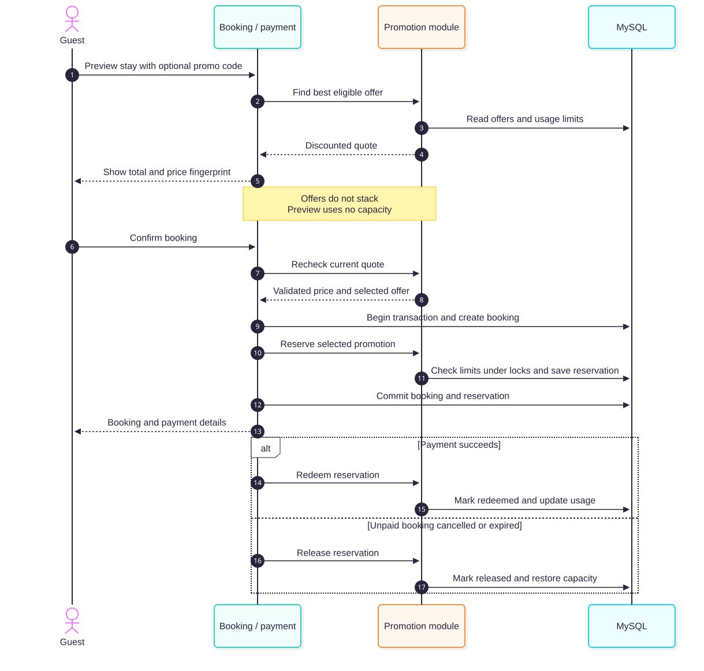

# Discount and promotion diagrams

These diagrams describe the implementation in the local checkout on 2026-11-22, based on commit `32c7c134c703bf7c2659bb7d2ad7688235e0bfc6`. They document code and schema definitions, rather than verified production state.

| Diagram | Editable source | Preview | Scalable image |
| --- | --- | --- | --- |
| Components and module boundaries | [Mermaid](components.mmd) | [PNG](components.png) | [SVG](components.svg) |
| Preview, checkout and redemption lifecycle | [Mermaid](sequence.mmd) | [PNG](sequence.png) | [SVG](sequence.svg) |
| Promotion entity relationships | [Mermaid](erd.mmd) | [PNG](erd.png) | [SVG](erd.svg) |

Edit the `.mmd` Mermaid sources to update the diagrams. The diagrams use the same Mermaid `redux-color` palette and `neo` look, 14px typography, white background, and standard flowchart, sequence and ERD conventions as the existing payout diagrams.

## Component diagram



The component view shows guest and hotel-admin clients, the promotion API and application rules, booking and payment integration, repositories, MySQL, and the separate reconciliation worker. Internal connections are module calls, not HTTP calls between microservices. The worker reuses application services and consults the booking module before repairing a reservation. Inventory, auditing and payment-provider internals are summarized.

Hotel-admin endpoints are mounted under `/api/v1/admin/hotels/:hotelId/promotions`; authenticated guest preview is `POST /api/v1/promotions/preview`. Management requires hotel-scoped `promotion.read` or `promotion.manage` permission as appropriate. Campaigns start as drafts, only drafts can be edited, and updates use optimistic version checks. Activation, pause and archive have explicit state-transition checks.

## Sequence diagram



The simplified sequence shows the main prepay flow with four participants. Booking and payment services share one lifeline for readability. Hold validation, error responses, transaction internals, pay-at-property handling and background repair are described below rather than expanded in the drawing. Reservation steps apply when an offer is selected; redeem/release runs in the transaction that changes booking state.

The sequence begins with an existing active room hold. Preview verifies the hold's ownership and expiry, obtains current room pricing and evaluates automatic offers plus an optional code. Omitting the code returns to automatic selection. Preview does not persist a redemption or consume usage.

Eligibility considers active status, currency, booking and stay windows, room scope, minimum nights, eligible subtotal, advance days, and code usage limits. Discounts are fixed amounts or percentages expressed in basis points, capped where configured and allocated across eligible rooms using integer minor units. Taxes and service fees are recalculated after discount. Offers never stack: the code must produce a strictly lower payable total to beat the best automatic offer; automatic wins a tie.

Checkout re-quotes and rejects a changed price when the caller supplies a different fingerprint. It creates the booking and reserves the selected promotion inside the booking transaction. Promotion status/version and code limits are checked under locks; both global and per-buyer counters include reserved plus redeemed usage. Automatic promotions also create redemption records, but do not change code usage counters.

Lifecycle behavior (the diagram shows the two prepay outcomes):

- Prepay success redeems the reservation atomically with booking confirmation.
- Unpaid cancellation or expiry releases it atomically with the booking transition.
- Pay-at-property booking confirms and redeems immediately within checkout, before commit.

The reconciliation worker inspects overdue reservations and current booking state. Confirmed, checked-in or completed bookings are redeemed; cancelled, expired or no-show bookings are released; pending bookings remain reserved for the booking expiry flow. Transitions are idempotent. Refunds preserve redeemed usage, and released redemptions are never revived. Late-payment refund handling is summarized rather than expanded.

Automatic and code rollout flags default to enabled in code; the diagrams do not assert their live environment settings.

## Entity relationship diagram



This is a selected-field ERD. The four promotion-owned tables are shown with hotel, room, user and booking context. Nullable fields are marked in column comments. Standard crow’s-foot connectors show cardinality: each booking may reference zero or one promotion, and each promotion may be referenced by many bookings.

- `promotions` supports both `automatic` and `code` modes. There is no separate discount table.
- `(hotel_id, normalized_code)` is unique. MySQL nullable unique-key semantics allow multiple automatic promotions with no code.
- `promotion_rooms` is a join table with a unique `(promotion_id, room_id)` pair. Selected-room scope uses these rows; all-room scope needs no target rows.
- `promotion_user_usage` has a unique `(promotion_id, buyer_id)` pair.
- `promotion_redemptions.booking_id` is unique, so a booking has at most one redemption. A redemption always references one promotion, booking, buyer and hotel.
- Promotion deletion is restricted by redemption history. The booking's promotion pointer is nullable with `ON DELETE SET NULL`.
- `created_by` and `updated_by` are UUID audit attributes without declared foreign keys in the promotion migration; no user relationship is implied for them.
- Bookings retain the discount, fingerprint and price-breakdown snapshot; redemption records retain promotion version, terms and allocation snapshots. Holds also have discount, fingerprint and price-breakdown fields; their inventory relationships are outside this ERD's scope.
- Common timestamps and unrelated supporting-table fields and relationships are omitted.

## Source references

Paths below are relative to this file and link to the inspected implementation.

- [Promotion public interface](../../../server/modules/promotion/index.js)
- [Guest preview route](../../../server/modules/promotion/api/guest.routes.js) and [admin routes](../../../server/modules/promotion/api/admin.routes.js)
- [Hotel-admin management](../../../server/modules/promotion/application/admin/managePromotions.js)
- [Eligibility and selection rules](../../../server/modules/promotion/domain/promotion.js), [money allocation](../../../server/modules/promotion/domain/money.js), and [rollout flags](../../../server/modules/promotion/domain/flags.js)
- [Quote resolution](../../../server/modules/promotion/application/resolveQuotePromotion.js) and [public automatic offers](../../../server/modules/promotion/application/applyAutomaticOffers.js)
- [Promotion lifecycle](../../../server/modules/promotion/application/lifecycle.js) and [reconciliation](../../../server/modules/promotion/application/reconcilePromotionReservations.js)
- [Promotion repository](../../../server/modules/promotion/infrastructure/promotion.repository.js) and [models](../../../server/modules/promotion/infrastructure/models/)
- [Table creation migration](../../../server/infra/database/migrations/20261107000000-create-promotion-tables.js) and [index alignment](../../../server/infra/database/migrations/20261108010000-align-promotion-indexes.js)
- [Booking preview](../../../server/modules/booking/application/guest/previewPromotion.js), [pricing](../../../server/modules/booking/application/pricing.service.js), and [checkout](../../../server/modules/booking/application/guest/createBookingFromHold.js)
- [Cancellation](../../../server/modules/booking/application/guest/cancelBooking.js), [expiry](../../../server/modules/booking/application/expiry/expireBookingIfDue.js), and [payment success](../../../server/modules/payment/application/webhooks/handlePaymentSucceeded.js)
- [Guest promotion client](../../../client/src/services/promotion.service.js) and [hotel-admin API client](../../../admin-client/services/api/promotions.ts)

The Mermaid sources were rendered with Mermaid CLI and the PNG previews visually inspected. No application code was changed.

## Regenerate images

Using Mermaid CLI 12.2 or later:

```bash
for source in docs/diagrams/discount-promotions/*.mmd; do
  mmdc -i "$source" -o "${source%.mmd}.svg" -b white
  mmdc -i "$source" -o "${source%.mmd}.png" -b white -s 2
done
```

