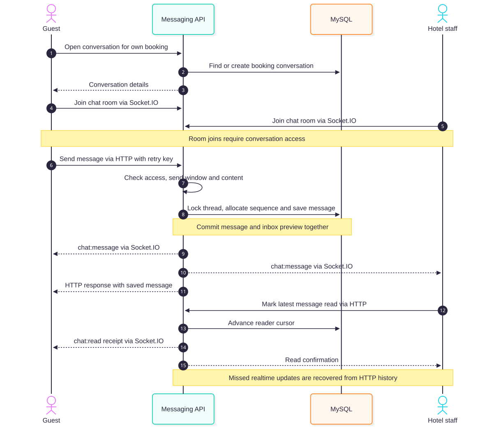

# Messaging feature diagrams

These diagrams describe guest-to-hotel messaging in the local checkout on 2026-11-23, based on commit `1480ac5a825413dc6df5f92753d6c11cfc9a0658`. They document the implementation rather than verified production state. The AI chat widget is a separate feature and is outside this scope.

The Mermaid `redux-color` palette, `neo` look, 14px typography and white background match the payout and discount/promotion diagrams. The sequence is deliberately simplified.

| Diagram | Editable source | Preview | Scalable image |
| --- | --- | --- | --- |
| Components and integrations | [Mermaid](components.mmd) | [PNG](components.png) | [SVG](components.svg) |
| Open, send, deliver and read | [Mermaid](sequence.mmd) | [PNG](sequence.png) | [SVG](sequence.svg) |
| Conversation data relationships | [Mermaid](erd.mmd) | [PNG](erd.png) | [SVG](erd.svg) |

## Components



Guest endpoints are under `/api/v1/conversations`; hotel endpoints are under `/api/v1/admin/conversations`. Guest access is scoped to the booking buyer. Hotel HTTP access requires the active hotel context and `chat.read` or `chat.respond`, with a cross-hotel conversation guard.

The messaging module owns conversations, message writes, ordered history, read cursors and guest inbox hiding. Repositories own Sequelize access. The booking module supplies booking context through its public interface. Booking-created events open conversations, while confirmed, cancelled and completed status events can add system messages. Subscribers are best-effort; opening a conversation from the guest API can create a missing thread lazily.

Sending messages and marking them read are HTTP writes. Socket.IO delivers committed messages, read receipts, inbox activity and transient typing updates. Both the guest `/user` and hotel `/property` namespaces use authorized conversation rooms. Socket access checks the guest identity or hotel membership. Realtime delivery is best-effort; persisted history remains available through HTTP.

Images are uploaded to private MinIO objects before sending. The send request references object keys scoped to the conversation and uploader; the service checks object existence, size, image type and reuse. Message attachment metadata is saved with the message transaction. Responses supply short-lived signed download URLs, defaulting to one hour. Image content is not stored in MySQL. The implementation allows up to five images, each at most 10 MiB.

## Sequence



The four-participant sequence shows a guest sending to hotel staff. The backend lifeline combines the HTTP application and realtime delivery adapter to keep it readable. The hotel-side send path follows the same persistence and delivery flow. Opening a thread checks booking ownership through the booking module before creation; the database step summarizes those queries. History pagination, image upload, system messages, typing, retry responses and error branches are described here rather than expanded in the drawing.

A new message locks the conversation row, allocates its next sequence number, saves the message and optional attachment metadata, and updates the inbox preview in one MySQL transaction. Socket delivery happens after commit. When a `clientMessageId` is supplied, retrying returns the existing message instead of inserting another; replay does not rebroadcast it. There is no durable socket-delivery acknowledgement or guarantee of receiving a realtime event.

Messages require an open conversation. Guest sending is allowed until a configurable number of days after checkout, defaulting to 30 days; hotel replies do not use that guest deadline. Reading history remains allowed. Text is limited to 4,000 characters; an image message may have an empty text body. Contact-sharing detection flags content for URL, phone or email patterns rather than rejecting it solely for that reason.

Read cursors are per user, including individual hotel staff members. A requested sequence is clamped to the thread's current sequence, and the stored cursor only moves forward. Read receipts are broadcast to both conversation namespaces; inbox activity updates recipients' badges.

## Entity relationships



The ERD includes all four messaging-owned tables and selected supporting entities. Unrelated hotel, booking and user relationships and common timestamps are omitted. Nullable attributes are marked in comments; connectors use standard crow's-foot cardinality.

- `conversations.booking_id` is nullable and unique: a booking has at most one conversation. Null is reserved for future hotel-level inquiries; the implemented creation flow is booking-based.
- Every conversation belongs to one hotel and one guest. There is no single hotel recipient user: access is hotel-scoped, and individual staff authors are stored on messages.
- Message ordering is unique on `(conversation_id, seq)`. Retry keys are unique on `(conversation_id, client_message_id)` when provided.
- A message sender user is nullable for system messages, or after a user is deleted with `ON DELETE SET NULL`; `sender_side` retains guest/hotel/system attribution.
- `conversation_reads` uses the composite primary key `(conversation_id, user_id)`. `last_notified_seq` and `muted_at` are schema attributes; their presence does not imply an implemented email-notification flow.
- Attachment object keys are globally unique, and `(message_id, position)` is unique. Each attachment belongs to exactly one message and references a MinIO object rather than another relational table.
- Guest deletion sets `guest_deleted_at` and hides the thread from that guest's inbox. It preserves hotel history; reopening from the booking restores the guest inbox entry.

## Source references

- [Messaging public interface](../../../server/modules/messaging/index.js)
- [Guest routes](../../../server/modules/messaging/api/guest.routes.js) and [hotel routes](../../../server/modules/messaging/api/admin.routes.js)
- [Conversation creation](../../../server/modules/messaging/application/ensureConversationForBooking.js) and [access checks](../../../server/modules/messaging/application/access.js)
- [Message send transaction](../../../server/modules/messaging/application/sendMessage.js), [history](../../../server/modules/messaging/application/getMessages.js), and [content flags](../../../server/modules/messaging/domain/content-flags.js)
- [Read acknowledgements](../../../server/modules/messaging/application/markConversationRead.js) and [read-state persistence](../../../server/modules/messaging/infrastructure/read-state.repository.js)
- [Attachment uploads](../../../server/modules/messaging/application/uploadAttachments.js) and [signed URLs](../../../server/modules/messaging/application/attachmentUrls.js)
- [Guest inbox hiding](../../../server/modules/messaging/application/deleteConversationForGuest.js)
- [Booking event subscribers](../../../server/modules/messaging/events/subscribers.js) and [system messages](../../../server/modules/messaging/application/postSystemMessage.js)
- [Socket event emission](../../../server/modules/messaging/infrastructure/socket-emitter.js) and [chat room handlers](../../../server/platform/realtime/namespaces/chat.js)
- [Conversation](../../../server/modules/messaging/infrastructure/models/conversation.model.js), [message](../../../server/modules/messaging/infrastructure/models/message.model.js), [attachment](../../../server/modules/messaging/infrastructure/models/message_attachment.model.js), and [read cursor](../../../server/modules/messaging/infrastructure/models/conversation_read.model.js) models
- [Guest messaging view](../../../client/src/views/Messages.vue) and [API client](../../../client/src/services/messaging.service.js)
- [Hotel inbox](../../../admin-client/pages/messages/index.vue) and [API client](../../../admin-client/services/api/messages.ts)

## Regenerate images

Using Mermaid CLI 12.2 or later:

```bash
for source in docs/diagrams/messaging/*.mmd; do
  mmdc -i "$source" -o "${source%.mmd}.svg" -b white
  mmdc -i "$source" -o "${source%.mmd}.png" -b white -s 2
done
```

The sources were rendered with Mermaid CLI and the PNG previews visually inspected. No application code was changed.
