# Monitoring architecture diagram

TravelNest's configured metrics pipeline and planned Loki logging pipeline,
documented on 2026-11-22. Solid arrows show configured flows; dashed arrows show
planned additions. The proposed logging destination is Grafana Cloud Logs
(managed Loki), not a Loki deployment inside k3s.

| Diagram | Editable Mermaid source | Rendered image |
| --- | --- | --- |
| Monitoring architecture | [architecture.mmd](architecture.mmd) | [SVG](architecture.svg) · [PNG](architecture.png) |



See the [architecture walkthrough](../../architecture/monitoring-architecture.md)
for component responsibilities, repository configuration, and logging scope.
The planned log pipeline is a logical part of Alloy, not necessarily a separate
Deployment. Exporters are grouped by function rather than namespace.

## Regeneration

Use Mermaid CLI to regenerate both images after changing the source:

```sh
mmdc -i docs/diagrams/monitoring/architecture.mmd -o docs/diagrams/monitoring/architecture.svg -b white
mmdc -i docs/diagrams/monitoring/architecture.mmd -o docs/diagrams/monitoring/architecture.png -b white -s 2
```

If Chrome must be selected explicitly, pass `-p <puppeteer-config.json>` with an
`executablePath` pointing to the installed browser. Keep the Mermaid block in
the architecture walkthrough synchronized with `architecture.mmd`.
