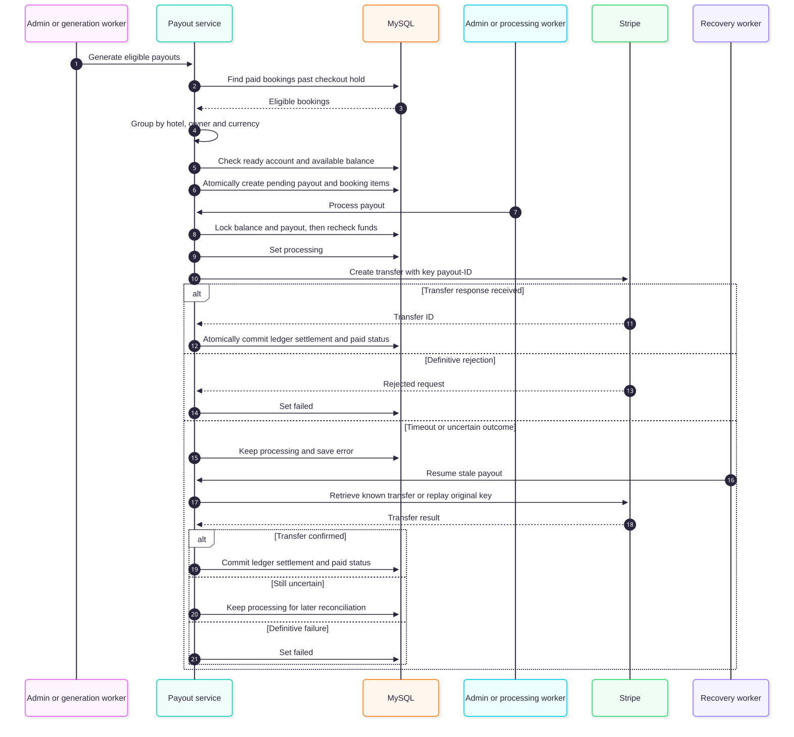

# Payout feature diagrams

These diagrams describe the payout design at [PR #202](https://github.com/bk-leducphuong/TravelNest-Hotel_Booking_System/pull/202), commit `6685a189ba19852d6c8282e155617306145b4fe3`, including its proposed automation. They are not a statement that this version is deployed. The ERD is a selected-field view of the Sequelize models, not the complete database schema.

| Diagram | Editable Mermaid source | Rendered image |
| --- | --- | --- |
| Components and integrations | [components.mmd](components.mmd) | [SVG](components.svg) · [PNG](components.png) |
| Booking-to-payout sequence | [booking-to-payout.mmd](booking-to-payout.mmd) | [SVG](booking-to-payout.svg) · [PNG](booking-to-payout.png) |
| Payout data relationships | [erd.mmd](erd.mmd) | [SVG](erd.svg) · [PNG](erd.png) |

## Components



The simplified diagram shows the main application boundaries. The backend groups account management, payout operations, webhook handling and ledger settlement. BullMQ runs in a separate worker process with Redis; its arrow represents reuse of the backend application services, not an HTTP call to Express. Both processes access MySQL through those services. Superadmin reads payout records through its finance API. Owner notifications and individual queues are omitted for clarity.

Manual generation lives at hotel admin `/payouts`; manual processing lives at `/payouts/:payoutId`. Both require `payment.process`. Connected-account creation, onboarding and sync also require that permission. The default hotel `owner` role lacks it, so these controls are hidden for owners. The superadmin finance page currently displays records without generate/process controls.

## Booking-to-payout sequence



Eligibility requires a confirmed/completed booking, a completed payment transaction, checkout before the hold cutoff, no pending/processing refund, no cancellation outcome requiring refund/manual review, and no existing payout item. Generation groups by hotel, owner and currency and skips groups without a ready connected account or available funds.

Generation reserves funds through pending payout rows; it does not transfer money. Processing claims the payout under database locks, rechecks funds, and creates the Stripe transfer with idempotency key `payout-<payout_id>`. Settlement writes balanced ledger entries and marks the payout paid in one database transaction. A ledger failure after a successful transfer keeps the payout processing for recovery. Transfer webhooks provide an additional reconciliation path, omitted from the sequence to keep the request/recovery flow readable.

`paid` means the transfer to the owner's Stripe Connect account has settled locally. Arrival in the owner's bank is a separate Stripe payout process.

Automation defaults: generation and processing flags off; generation interval one day when enabled; recovery interval five minutes; processing stale threshold sixty minutes. Recovery remains scheduled even when both automation flags are off.

## Entity relationships



- `payout_items.booking_id` is unique: one booking can belong to at most one payout item, across all payout statuses.
- `connected_payment_accounts.hotel_id` is nullable, permitting owner-level accounts.
- `payouts.transaction_id` is optional; generated batches keep per-booking source transaction references on payout items.
- `payouts.amount` is the actual transfer amount. Item net totals can exceed it when available balance is reduced by refund obligations or owner debt; `metadata.owner_debt_deduction` records the adjustment.
- `ledger_entries.payout_id` is nullable because the ledger also records non-payout events. The settlement key is `payout_paid:<payout_id>`.
- Supporting entities show only selected fields. Relationships unrelated to payouts are omitted.

## Source code

Paths below are relative to the repository root; use the PR commit above to inspect the documented version.

- `server/modules/payout/application/payout.service.js`
- `server/modules/payout/application/settleTransfer.js`
- `server/modules/payout/application/reconcileTransfer.js`
- `server/modules/payout/infrastructure/payout.repository.js`
- `server/modules/payout/jobs/payouts.js`
- `server/modules/payout/infrastructure/models/{payout,payout_item}.model.js`
- `server/modules/payment/infrastructure/models/{connected_payment_account,ledger_entry,ledger_account}.model.js`
- `admin-client/pages/payouts/`
- `superadmin-client/pages/finance/payouts.vue`

## Regeneration

Use Mermaid CLI to render each `.mmd` file to SVG and PNG. For example, with `mmdc` installed:

```sh
mmdc -i docs/diagrams/payouts/components.mmd -o docs/diagrams/payouts/components.svg -b white
mmdc -i docs/diagrams/payouts/components.mmd -o docs/diagrams/payouts/components.png -b white -s 2
```

Repeat for `booking-to-payout` and `erd` after changing their sources.
