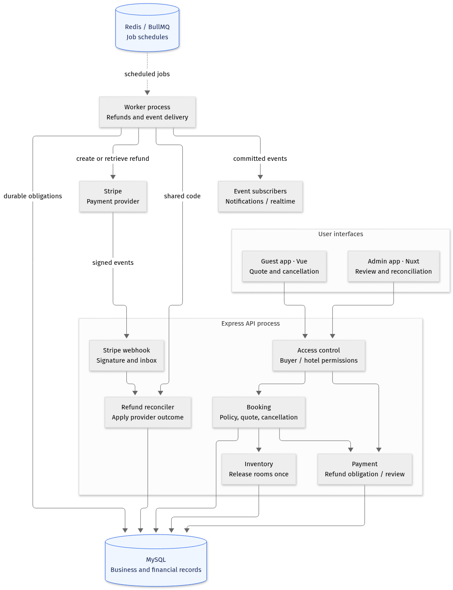
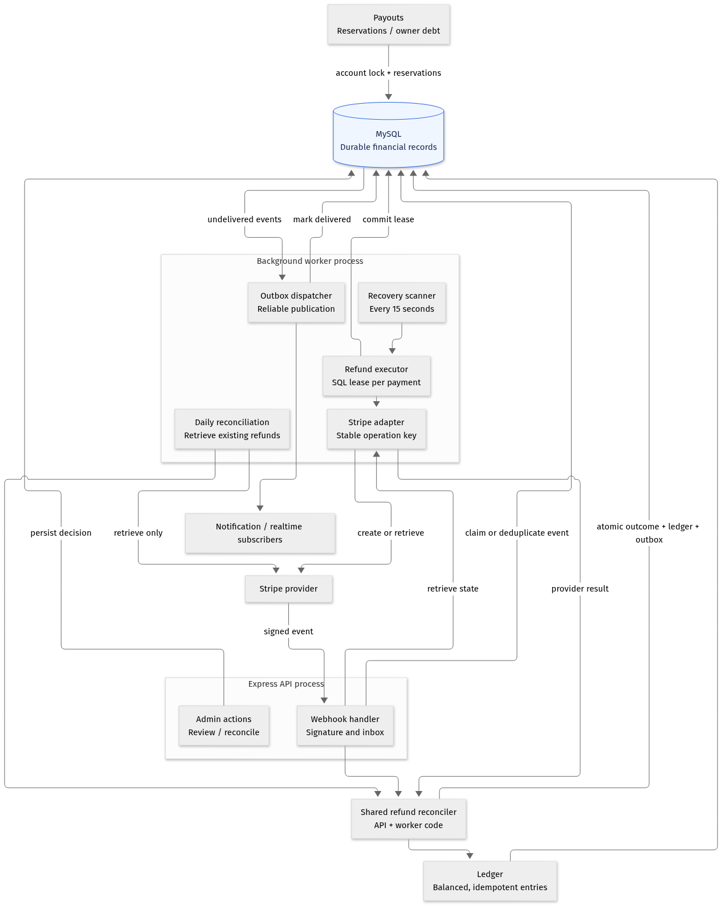

# Cancellation and refund workflow

Implements issue #137. Cancellation ends the stay reservation; a refund is a separate, durable financial operation. All provider calls happen outside the cancellation transaction.

For local setup, sandbox acceptance cases, database checks and failure recovery verification, use the [local stack test plan](../testing/cancellation-refunds-local-test-plan.md).

## Component diagrams

These diagrams show logical responsibilities and dependencies, rather than the order of requests. Booking, payment and inventory are modules within the Express application; they are not independently deployed services. API and background worker are separate processes that share application code and MySQL.



Guest cancellation commits the booking status, inventory release, refund obligation or review case, and outbox record in one database transaction. The worker later contacts Stripe. Redis schedules the work; MySQL retains the obligation if a queue job is lost. Manual-review cases require an authorized decision before any refund can execute.



The worker and webhook handler use the same refund reconciler. It applies provider outcomes and ledger changes atomically. The daily sweep retrieves existing provider operations; it does not create refunds. The outbox dispatcher publishes committed outcomes for notification and realtime subscribers. Payout calculations account for reserved refunds and any debt after an owner has already been paid.

Editable Mermaid sources: [overview](../diagrams/cancellation-refunds/components-overview.mmd) and [processing](../diagrams/cancellation-refunds/components-processing.mmd). Vector exports: [overview SVG](../diagrams/cancellation-refunds/components-overview.svg) and [processing SVG](../diagrams/cancellation-refunds/components-processing.svg).

## Business rules

- Guest cancellation automatically requests any eligible refund. Clients cannot disable it with `processRefund=false`.
- A cancellation quote is scoped to the authenticated buyer, stored on the booking, and expires after five minutes. Confirmation rechecks the policy and refundable balance under locks. A changed or expired quote returns `409 CANCELLATION_QUOTE_EXPIRED` and requires renewed acknowledgement.
- New bookings store version 2 policy snapshots: per-room gross amount in cents, the rule and percentages, absolute cancellation deadline, hotel timezone, and check-in instant. Taxes and service fees are allocated proportionally to room subtotals, with the final room receiving the rounding residual; each room's policy applies to that allocated gross amount.
- A positive quote is capped by the captured payment less succeeded and reserved refunds. The quote identifies money already refunded or reserved separately from the policy cancellation fee. Timing is an estimate after processing, not a promise that the cardholder has received money.
- Missing, legacy, invalid, or incomplete snapshots never use today's hotel rules as historical truth. Paid bookings enter manual review. Missing provider charge identifiers and unsupported currencies also require review.
- A review case is a non-executable, zero-amount `refunds` row with `eligibility=manual_review` and `workflow_state=manual_review`. Its amount is undecided, not a $0 refund. The guest quote explicitly returns null refund/fee amounts for manual review. It reserves the captured amount conservatively against owner payouts. Staff can approve an amount or reject with amount 0; the decision and reason are persisted. Review cases never reach Stripe.
- Unpaid cancellations record a no-refund decision. A later successful payment cannot revive a cancelled/expired booking: the payment webhook records a full compensation obligation instead.
- Admin force-cancellation retains its explicit refund switch. When enabled, a blank amount means the full remaining captured amount, regardless of the guest policy. Overrides require the existing admin permission and reason.
- Cancellation operates on the entire booking and its `booking_rooms`, not on one room row independently. Legacy group rows without reliable snapshots require human review.

## Transaction and lock boundaries

Cancellation locks the booking first, then its payment. In a single MySQL transaction it records the refund/review case, changes booking status with a precondition, releases inventory once, stores `cancellation_decision`, and inserts outbox events. A repeated cancellation returns the stored decision and current refund status.

Admin refunds and review decisions also acquire booking then payment locks. The payment lock serializes balance reservations across partial refunds, cancellations and retries. `refunds.idempotency_key` is a permanent unique business key. No unsupported MySQL filtered index is used.

Refund execution claims a five-minute database lease and serializes submissions for a payment. It commits the lease before network I/O. Stripe receives `refund-{refund.id}` as its stable idempotency key and `refund_record_id` metadata. Redelivered BullMQ work is safe even after queue-job history has expired.

Provider results and refund webhooks use the same reconciler. Refund state, payment totals, ledger postings and outcome outbox records commit together under the payment lock. Existing succeeded rows are checked for missing ledger postings rather than skipped. A provider-confirmed refund failure after submission reverses the original posting once and becomes visible to staff; stale success responses cannot revive a failed provider refund.

## Recovery and operations

The worker process starts two queues:

- `refundRecovery`: scans SQL obligations every 15 seconds, runs up to five independent provider attempts concurrently, and delivers outbox events.
- `refundReconciliation`: compares recorded provider operations and their ledger effects daily, including completed and needs-attention cases. This sweep never creates a new Stripe refund.

The database remains the source of pending work if Redis loses jobs. Temporary failures retain the reservation and back off exponentially from 30 seconds, capped at one hour. After eight attempts, uncertain operations remain `processing/needs_attention`; this is the durable dead-letter list in the admin refund screen, not a released financial reservation. Staff may request reconciliation again using the same operation.

A lost response is not a failed refund. Recovery first retrieves the recorded provider refund or searches all refunds on the charge for the record's metadata. After 23 hours from first submission, it never creates another refund unless the original operation has been resolved. This is deliberately inside Stripe's minimum 24-hour key-retention window. A provider-confirmed failed/cancelled refund requires a new, reviewed operation rather than blindly replaying its old provider key.

Webhook receipts use a durable inbox: completed events are deduplicated, active processing returns 503 so Stripe retries, and failed/stale receipts can be reclaimed. Refund-level events fetch current provider state. `charge.refunded` reconciles the complete provider refund list, not a possibly truncated embedded list. Signature verification and raw request bodies remain intact.

Admin refunds show manual-review and needs-attention cases, their errors, and the review/reconciliation actions. Guests can refresh refund status from either the cancellation page or booking record. English and Vietnamese text use the actual quote and status.

Structured error signals are `refund_attention_required`, `Refund reconciliation failed`, and `Refund reconciliation could not locate provider operation`; the daily completion log includes `checked` and `drift`. Connect log alerts to these signals in the deployment's alerting configuration. The SQL outbox retains failed event deliveries for retry; duplicate notifications use the stable refund ID.

Useful read-only operational queries:

```sql
SELECT id, booking_id, transaction_id, workflow_state, attempt_count,
       first_attempt_at, next_retry_at, failure_message
FROM refunds
WHERE workflow_state IN ('manual_review', 'needs_attention', 'unknown')
ORDER BY requested_at;

SELECT event_type, COUNT(*) AS undelivered, MIN(created_at) AS oldest
FROM payment_outbox
WHERE delivered_at IS NULL
GROUP BY event_type;
```

`REFUND_ETA_MIN_BUSINESS_DAYS` and `REFUND_ETA_MAX_BUSINESS_DAYS` configure the displayed arrival estimate (defaults: 5 and 10). This release automatically executes USD refunds, matching guest checkout; other currencies require review.

## Owner payouts and accounting

Refunds reverse the original payment commission allocation, never today's fee configuration. Cumulative cent allocation closes rounding residuals across partial refunds. Returned refunds reverse their postings rather than deleting accounting history.

Refund reservations and payout claims share a lock on the hotel's payable account. Pending/processing payouts remain reserved until their cash debit and paid status commit together. A lost transfer response stays processing and can be settled by its transfer webhook, using the same ledger posting key.

If the owner was already paid, a refund debits hotel payable into a negative balance. That balance is the explicit owner debt. A provider-confirmed failure returns cash but does not erase an approved cancellation entitlement: any outstanding entitlement still reserves owner funds until a replacement refund settles. A staff-created replacement must cover that entitlement and becomes the tracked refund. Future payment credits offset it, and automatic payout generation reduces new payouts to the remaining net balance, recording `owner_debt_deduction` in payout metadata. A manual payout above the available net balance is rejected. No automatic debit of an owner's external bank account is attempted.

During rollout, existing queued payout amounts might exceed the new available balance. Such payouts are blocked; staff must review/cancel and regenerate them, rather than bypassing the balance guard. A missing original payment ledger also requires accounting review; the code does not fabricate historical commission allocations.

## API changes

| Endpoint                                                          | Behavior                                                                                                                                       |
| ----------------------------------------------------------------- | ---------------------------------------------------------------------------------------------------------------------------------------------- |
| `GET /api/v1/bookings/:bookingId/cancellation-quote`              | Buyer-owned quote with `quoteId`, `expiresAt`, captured/refundable amounts, policy fee, currency, destination and estimate.                    |
| `DELETE /api/v1/bookings/:bookingId`                              | Body `{ "quoteId": "..." }`; commits cancellation and durable decision, returns pending refund/review state. Duplicate requests replay safely. |
| `GET /api/v1/bookings/:bookingId/refund`                          | Buyer-owned decision and current refund status.                                                                                                |
| `POST /api/v1/admin/payments/transactions/:transactionId/refunds` | Queues a financial adjustment; required `Idempotency-Key` is scoped to the actor and limited to 200 characters.                                |
| `POST /api/v1/admin/payments/refunds/:refundId/retry`             | Requests reconciliation of an uncertain operation; never creates an uncorrelated replacement.                                                  |
| `POST /api/v1/admin/payments/refunds/:refundId/review`            | Hotel-authorized `{ "amount": 0, "reason": "..." }` rejects a review; a positive amount approves and queues it.                                |

## Rollout

1. Apply migration `20261104000000-durable-cancellation-refunds.js` before starting the updated API or workers. It adds booking quote/decision JSON, refund keys/leases/retry state, and `payment_outbox`; it can be restarted safely after interrupted MySQL DDL.
2. Deploy the updated API and worker together through the project's normal GitOps flow. Verify both refund workers are ready before enabling guest traffic. The worker deployment, as well as the API deployment, must use the new image.
3. Deploy guest/admin clients with the quote contract. Older clients cannot cancel without obtaining and confirming a quote; plan the release accordingly.
4. Configure Stripe to deliver `refund.created`, `refund.updated`, `refund.failed`, and `charge.refunded` (legacy `charge.refund.updated` remains handled). Configure operational alerts on the signals above and on old pending obligations/outbox entries.
5. Exercise Stripe sandbox success, pending, failure and webhook retry cases, then inspect refunds, ledger and outbox records. No live payment/refund is part of automated testing.
6. Do not backfill historical policy snapshots from current rules or automatically resubmit legacy refund rows without keys. Historical cancelled bookings without decisions are shown as requiring review and need an explicit support/accounting audit.

Migration rollback is for a controlled rollback with workers stopped. It removes the new operational columns and outbox and therefore must not run over uncompleted live obligations. Production migrations, webhook configuration and deployments require the project's normal explicit approval.

## Verification

Unit tests cover snapshot calculations, quote validation, cancellation replay and worker safety. MySQL Testcontainers integration tests cover concurrent cancellation and partial refunds, transaction rollback, worker duplicates, lost provider responses, webhook correlation/reclaim, late payment compensation, original commission reversal, provider failure reversal, owner debt, review decisions and migration restart/rollback. Guest component tests cover quoted amounts, confirmation and stale quote acknowledgement; admin tests and type checking cover the changed review UI surface.
