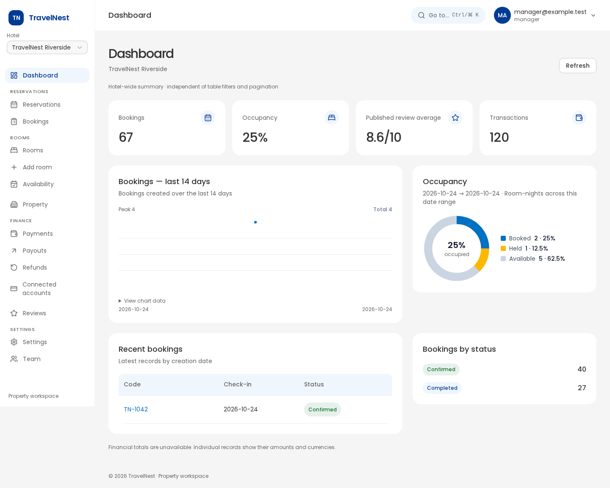

# Hotel admin redesign — visual evidence

Captured 25 October 2026 with isolated synthetic fixtures. Desktop is 1440px in English; mobile is 375px in Vietnamese. The browser suite also checks 768px and 1280px. These are UI acceptance screenshots, not live hotel data.

[Progress, test results and adaptation scorecard](../hotel-admin-redesign.md).

## Before and reference provenance

[Original admin overview](./before-overview.png) is the available baseline. A complete per-route before set was not captured. Reference images below are unchanged copies of the user-supplied `docs/design/hotel_admin/` PNGs; their palette and unsupported product modules are intentionally adapted as documented in the scorecard.

| Reference | Original filename |
| --- | --- |
| [reservation](./reference-reservation.png) | 04. Reservation - Desktop.png |
| [rooms](./reference-rooms.png) | 06. Room_Rooms - Desktop.png |
| [room-editor](./reference-room-editor.png) | 07. Room_New Room - Desktop.png |
| [finance](./reference-finance.png) | 10. Finance_Finance - Desktop.png |
| [invoice](./reference-invoice.png) | 11. Finance_Invoice - Desktop.png |
| [reviews](./reference-reviews.png) | 12. Reviews - Desktop.png |

## After screenshots

| Screen / route | English desktop | Vietnamese mobile | Reference counterpart |
| --- | --- | --- | --- |
| dashboard · `/` | [1440px](./dashboard-en-desktop.png) | [375px](./dashboard-vi-mobile.png) | [Reference](./reference-reservation.png) |
| rooms · `/rooms` | [1440px](./rooms-en-desktop.png) | [375px](./rooms-vi-mobile.png) | [Reference](./reference-rooms.png) |
| room-create · `/rooms/new` | [1440px](./room-create-en-desktop.png) | [375px](./room-create-vi-mobile.png) | [Reference](./reference-room-editor.png) |
| room-detail · `/rooms/room-1` | [1440px](./room-detail-en-desktop.png) | [375px](./room-detail-vi-mobile.png) | [Reference](./reference-room-editor.png) |
| bookings · `/bookings` | [1440px](./bookings-en-desktop.png) | [375px](./bookings-vi-mobile.png) | [Reference](./reference-reservation.png) |
| booking-detail · `/bookings/booking-1` | [1440px](./booking-detail-en-desktop.png) | [375px](./booking-detail-vi-mobile.png) | Shared foundations; no direct PNG |
| reservations · `/reservations` | [1440px](./reservations-en-desktop.png) | [375px](./reservations-vi-mobile.png) | [Reference](./reference-reservation.png) |
| availability · `/availability` | [1440px](./availability-en-desktop.png) | [375px](./availability-vi-mobile.png) | Shared foundations; no direct PNG |
| properties · `/properties` | [1440px](./properties-en-desktop.png) | [375px](./properties-vi-mobile.png) | Shared foundations; no direct PNG |
| property-detail · `/properties/hotel-1` | [1440px](./property-detail-en-desktop.png) | [375px](./property-detail-vi-mobile.png) | Shared foundations; no direct PNG |
| reviews · `/reviews` | [1440px](./reviews-en-desktop.png) | [375px](./reviews-vi-mobile.png) | [Reference](./reference-reviews.png) |
| review-detail · `/reviews/review-1` | [1440px](./review-detail-en-desktop.png) | [375px](./review-detail-vi-mobile.png) | [Reference](./reference-reviews.png) |
| finance · `/payments` | [1440px](./finance-en-desktop.png) | [375px](./finance-vi-mobile.png) | [Reference](./reference-finance.png) |
| transaction-detail · `/payments/transactions/transaction-1` | [1440px](./transaction-detail-en-desktop.png) | [375px](./transaction-detail-vi-mobile.png) | [Reference](./reference-invoice.png) |
| refunds · `/payments/refunds` | [1440px](./refunds-en-desktop.png) | [375px](./refunds-vi-mobile.png) | Shared foundations; no direct PNG |
| payouts · `/payouts` | [1440px](./payouts-en-desktop.png) | [375px](./payouts-vi-mobile.png) | [Reference](./reference-finance.png) |
| payout-detail · `/payouts/payout-1` | [1440px](./payout-detail-en-desktop.png) | [375px](./payout-detail-vi-mobile.png) | Shared foundations; no direct PNG |
| connected-accounts · `/payouts/connected-accounts` | [1440px](./connected-accounts-en-desktop.png) | [375px](./connected-accounts-vi-mobile.png) | Shared foundations; no direct PNG |
| settings · `/settings` | [1440px](./settings-en-desktop.png) | [375px](./settings-vi-mobile.png) | Shared foundations; no direct PNG |
| team · `/settings/team` | [1440px](./team-en-desktop.png) | [375px](./team-vi-mobile.png) | Shared foundations; no direct PNG |

## Dashboard preview

## Review notes

- The light grouped shell, guest blue actions, card surfaces, table headers, chart legends and section hierarchy match the supported reference intent. Unsupported metrics are omitted rather than simulated.
- Missing photos have explicit placeholders. Separate browser tests verify object-key URL resolution, successful decoding, and broken-image fallbacks.
- Mobile tables/calendars scroll inside labelled, keyboard-focusable containers. Long Vietnamese labels may wrap the header onto two rows while keeping hotel context and actions available.
- Automated accessibility checks pass across 20 screens in English desktop and Vietnamese mobile; manual focus/keyboard workflows are exercised separately. Live provider integration remains the release check described in the progress report.
