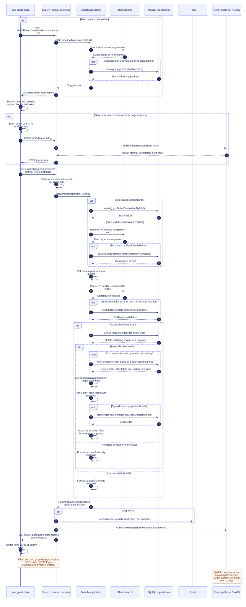

# TravelNest hotel search

Implementation-based component architecture and sequence diagrams, traced on 2026-10-24.

## Architecture

[Editable Mermaid source](hotel-search-architecture.mmd)

The backend box contains modules of the same Express application. Solid arrows show request/data dependencies; dashed arrows show logging, events, and best-effort history updates. Elasticsearch discovers candidates; MySQL verifies availability and computes prices for the selected stay. Redis stores signed-in users' recent searches, rather than caching search results.

## Sequence

[Editable Mermaid source](hotel-search-sequence.mmd)

- Autocomplete and text destination resolution fall back to MySQL when Elasticsearch has no match or fails.
- Hotel candidate discovery falls back to MySQL when Elasticsearch is unavailable, fails, or returns zero hits for a text location. Inventory and prices are always queried from MySQL.
- Price filtering, ranking, facets, and pagination happen after inventory and room-price enrichment. Favorite status is attached to the resulting page.
- The client awaits a separate `POST /search/log` before fetching results for new base criteria. The results controller also publishes a search event. The diagram shows both existing paths.
- Recent-search writes and event publication initiated after the hotel search are not awaited by the results controller. The Go analytics service consumes NATS events and persists MongoDB `search_logs` independently.
- Empty candidate/availability sets return successful empty results. Validation and infrastructure error responses are omitted to keep the sequence focused on search and its fallbacks.

## Code references

- UI entry and autocomplete: [`client/src/components/SearchBar.vue`](client/src/components/SearchBar.vue)
- Route watcher, search/log ordering, filters, and rendering: [`client/src/views/SearchResults.vue`](client/src/views/SearchResults.vue), [`client/src/stores/search/actions.js`](client/src/stores/search/actions.js)
- HTTP endpoints: [`client/src/services/search.service.js`](client/src/services/search.service.js), [`server/modules/search/api/guest.routes.js`](server/modules/search/api/guest.routes.js)
- Controller side effects: [`server/modules/search/api/search.controller.js`](server/modules/search/api/search.controller.js)
- Pipeline, ranking, pagination: [`server/modules/search/application/searchHotels.js`](server/modules/search/application/searchHotels.js), [`server/modules/search/application/search-pipeline.js`](server/modules/search/application/search-pipeline.js), [`server/modules/search/application/search-response.js`](server/modules/search/application/search-response.js)
- Destination lookup and autocomplete: [`resolveDestination.js`](server/modules/search/application/resolveDestination.js), [`autocomplete.js`](server/modules/search/application/autocomplete.js)
- Availability, pricing, and database fallback: [`server/modules/search/infrastructure/search.repository.js`](server/modules/search/infrastructure/search.repository.js)
- History and events: [`recentSearches.js`](server/modules/search/application/recentSearches.js), [`saveSearchLog.js`](server/modules/search/application/saveSearchLog.js), [`server/events/nats.adapter.js`](server/events/nats.adapter.js)
- Analytics consumption and persistence: [`services/analytics/internal/events/consumer.go`](services/analytics/internal/events/consumer.go), [`services/analytics/internal/mongo/repository.go`](services/analytics/internal/mongo/repository.go)
