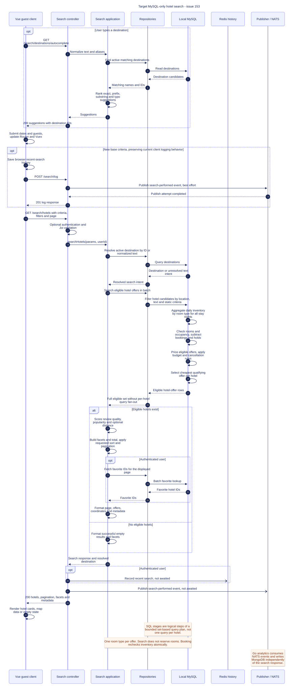

# TravelNest: target MySQL-only hotel search

Proposed post-migration design for [issue #153](https://github.com/bk-leducphuong/TravelNest-Hotel_Booking_System/issues/153), drawn on 2026-10-24. These diagrams describe the intended completed migration; they do not claim it is already implemented.

## Architecture

[Editable Mermaid](hotel-search-mysql-architecture.mmd) · [PNG](hotel-search-mysql-architecture.png)

The Express application and MySQL share the VPS/cluster. Catalog, search, and identity repositories are modules within the application, not separate microservices. Solid arrows indicate synchronous request/data dependencies. Dashed arrows indicate history and analytics side effects. JSON responses return along the request path; the sequence diagram shows them explicitly.

MySQL holds destination and hotel metadata, daily inventory and prices, cancellation rules, review/popularity aggregates, and favorites. Redis stores authenticated recent searches. NATS, the Go analytics service, and MongoDB remain the background analytics path. Their grouping describes function, not a separate hosting location.

## Search sequence

[Editable Mermaid](hotel-search-mysql-sequence.mmd) · [PNG](hotel-search-mysql-sequence.png)

All API paths in the sequence are under `/api/v1`.

### Proposed search behavior

1. Normalize destination names and aliases, including Vietnamese accents and `đ → d`. Prefer explicit IDs and exact matches. Rank prefix/substring and conservative typo suggestions.
2. Filter hotel candidates by resolved destination, supported hotel-name/geographic intent, and static constraints.
3. Aggregate room inventory in batches across candidates. Check every night in `[checkIn, checkOut)`, require open inventory, subtract booked and held rooms, and use the minimum nightly available quantity.
4. Require sufficient identical room types and occupancy for the party. Mixed-room-type allocation is deferred.
5. Calculate prices for the requested stay and room count, with explicit currency and price units. Apply budget and offer-specific cancellation constraints before choosing the cheapest eligible offer per hotel.
6. Rank with Bayesian-adjusted review quality, diminishing-return recent popularity, and distance only when a meaningful geographic anchor exists. Honor explicit sorts and use stable hotel-ID tie-breakers.
7. Build facets and totals over the full eligible set, then sort and paginate. Enrich only the displayed page with favorite status.
8. Return the existing response envelope or migrate all affected consumers explicitly. Empty eligibility sets are successful empty responses.

### Interpretation and boundaries

- Database self-messages represent logical SQL stages, normally composed into CTEs/derived tables and a bounded set of batched queries. They do not imply one network round trip per stage.
- This illustration calculates ranking/facets/pagination in the search application after retrieving the eligible set, appropriate as an initial design for the seeded scale. A later implementation may push these operations into SQL while preserving identical semantics.
- The separate awaited client `POST /search/log` and subsequent GET-triggered publication preserve current behavior. Issue #153 requires reviewing analytics deduplication; the final event policy remains a separate explicit decision.
- A small destination cache with refresh may be added as an optimization. It is not required by these diagrams.
- Search reads availability without reserving it. Checkout/booking must atomically recheck and hold inventory.
- The diagram focuses on normal search, autocomplete, and empty results. Validation failures, database errors, per-hotel availability endpoints, background snapshot maintenance, and media delivery are omitted.
- Existing pre-migration diagrams remain in `hotel-search-architecture.*` and `hotel-search-sequence.*` for comparison.
